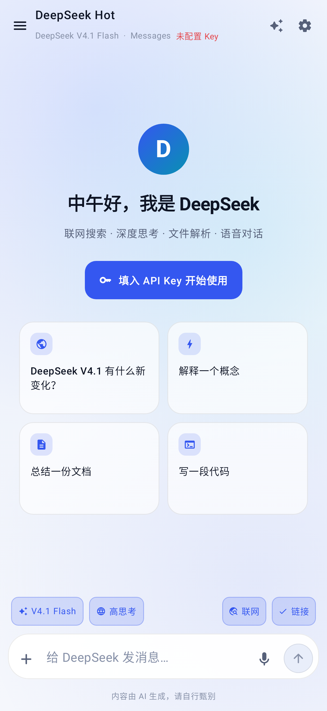
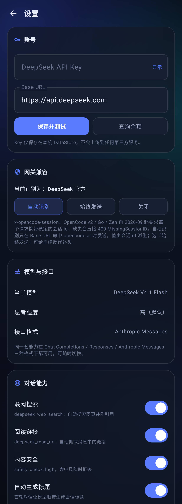

# DeepSeek Hot

为 [DeepSeek 全家桶应用 API](https://api-docs.deepseek.com/zh-cn/guides/build_a_chatbot) 打造的第三方原生 Android 客户端。基于官方开源示例 [deepseek-ai/chat-demo](https://github.com/deepseek-ai/chat-demo) 的能力集合，用 **Kotlin + Jetpack Compose** 重写，并加入模型管理、思考强度、实时用量与速度、三协议切换等增强能力。

> 仓库内已附带构建产物 `deepseek-hot-v1.1.0.apk`（debug 签名，可直接 `adb install`），也可按下文步骤自行编译。

- 包名：`com.hotsteel.deepseekhot`
- 最低系统：Android 8.0（API 26），目标 API 35
- 技术栈：Kotlin 2.0 / Compose Material 3 / OkHttp / DataStore / kotlinx.serialization，无 JNI、无 XML 布局

## 界面预览

<p align="left">
  
  
  
</p>

> 截图为 Robolectric 真实渲染（Compose 原生绘制），浅色/深色两套主题分别展示。

## 功能

### 承自 chat-demo

| 能力 | 实现方式 |
| --- | --- |
| 联网搜索 | `deepseek_web_search` 工具，搜索卡片展示标题/站点/图标/摘要，可展开、可跳转 |
| 深度思考搜索 | 思考模式 + 搜索工具，思考过程可折叠，显示思考用时 |
| 阅读链接 | `deepseek_read_url` 工具，展示抓取到的网页标题与地址 |
| 文件输入 | Files API 上传（PDF / Office / 图片 / 文本），对话中以 `file_id` 引用 |
| 内容安全 | `safety_check: high`，拒答时丢弃已下发的正文并展示拦截提示 |
| 会话标题 | `title: {enabled: true}` 自动生成，可手动重命名 |
| 编辑消息 / 重新生成 / 继续生成 | 编辑后截断重发；重新生成保留历史版本可左右切换；截断或手动停止后可续写 |
| 朗读回答 / 语音输入 | `/v1/tools/tts` 流式音频落盘播放；录音 16kHz WAV 上传 `/v1/tools/asr` |
| 引用角标 | 解析 `citations_delta` / `url_citation`，以来源条形式展示并跳转 |
| Markdown | 自研解析器：标题、列表、引用、表格、代码块（语言标签 + 复制）、链接、行内样式 |
| 浅色 / 深色主题 | 双套手调色板 + 动态取色（Android 12+） |
| 历史导出 / 导入 | 全量会话 JSON 导出与导入（SAF，本应用格式） |
| 多会话管理 | 新建、切换、重命名、置顶、删除、搜索 |

### 本次新增

1. **模型自动获取与自由选择**：启动后调用 `GET /models`，读取展示名、上下文窗口、输出上限、输入模态、支持的 `effort` 档位与默认档位；失败时回退到内置列表，可手动刷新。
2. **思考强度可调**：`none / low / high / max`，按协议自动映射为 `thinking` + `reasoning_effort`（Chat）、`reasoning.effort`（Responses）、`thinking` + `output_config.effort`（Anthropic）。
3. **动态用量与余额**：`GET /user/balance` 实时余额（总额 / 赠金 / 充值）；每条回答显示输出 Token、首字延迟（TTFT）、生成速度（tok/s）、按官方价目估算的费用；本地累计今日/全部请求、Token 与花费。
4. **三种接口格式可选**：Chat Completions、Responses、Anthropic Messages 一键切换，流式解析器各自独立实现，统一映射为同一套内容块模型。
5. **界面与动效**：极光渐变背景、玻璃卡片、流式光标、思考/搜索卡片的展开动画、发送按钮形变、录音波形、消息入场动画、骨架微光、页面转场等。

## 网关兼容：OpenCode v2 / Go / Zen

Base URL 填 `opencode.ai` 系地址时自动切换端点形态与会话头，三种协议都能用：

| 网关 | Base URL | Chat | Responses | Anthropic |
| --- | --- | --- | --- | --- |
| OpenCode v2（Console，按量） | `https://opencode.ai/inference` | `/openai/v1/chat/completions` | `/openai/v1/responses` | `/anthropic/v1/messages` |
| OpenCode Go（订阅） | `https://opencode.ai/inference/go` | 同上 | 同上 | 同上 |
| Zen（旧版） | `https://opencode.ai/zen/v1` | `/chat/completions` | `/responses` | `/messages` |
| Go（旧版） | `https://opencode.ai/zen/go/v1` | `/chat/completions` | `/responses` | `/messages` |

- 粘完整端点（例如 `.../v1/chat/completions`）也可以，会自动剥回根地址再按协议拼路径。
- **`x-opencode-session`**：自 2026-09 起 Go 要求每个请求带稳定的会话 id，缺失直接 `400 MissingSessionID`；Console 也用它做路由与提示词缓存。本应用默认按 Base URL 自动识别，值由会话 id 派生（`ses_` + 32 位），切会话即换 id；设置页可改为「始终发送」（给自建反代补头）或「关闭」。
- 请求同时带 `User-Agent: deepseek-hot/1.1.0 (Android)`，而不是 `okhttp/4.12.0` 这类通用库名——OpenCode 明确要求客户端自报身份。
- 鉴权沿用协议规则：Anthropic 走 `x-api-key`，OpenAI 系走 `Authorization: Bearer`。
- 这些网关没有 Files / 余额 / 语音接口，对应入口会自动隐藏或给出明确提示；余额面板改为引导去 Console 查看。

## 依赖升级工作流

`.github/workflows/bump-dependencies.yml`：**只手动触发**（`workflow_dispatch`，没有 schedule，也不随 push 运行），一键把全部组件拉到各自最新稳定版：

- Gradle wrapper（查 `services.gradle.org/versions/current`）
- `gradle/libs.versions.toml` 里的每一项：AGP、Kotlin、Compose BOM、AndroidX、DataStore、kotlinx、OkHttp、Coil、JUnit、Robolectric
- 工作流自身用到的 GitHub Actions（查 releases/latest）

策略与安全边界：

- 只接受稳定版，`alpha / beta / rc / dev / preview / snapshot / eap` 一律不选。
- 升级后立即跑 `:app:assembleDebug` 与 `:app:testDebugUnitTest`；**即使编译失败也照样开 PR**，失败日志尾部会贴进 PR 正文，标记为需要人工跟进，不会丢掉已算出的结果。
- 变更走 PR（分支 `chore/bump-dependencies`），不直接推 main；PR 已存在时原地更新。
- 输入项：`dry_run`（只看差异）、`include_gradle`、`include_actions`、`only`（如 `okhttp,coil`）。

本地等价操作：

```bash
python3 scripts/bump-deps.py --dry-run   # 只看会升什么
python3 scripts/bump-deps.py             # 直接改文件，然后自己编译验证
```

## 构建

```bash
# 需要 JDK 17+、Android SDK（platform 35 / build-tools 35）
export ANDROID_HOME=/path/to/android-sdk
echo "sdk.dir=$ANDROID_HOME" > local.properties

./gradlew :app:assembleDebug
# 产物：app/build/outputs/apk/debug/app-debug.apk

# 单元测试（Markdown 解析器 6 个 + 网关识别 8 个，另有 3 个截图用例默认 @Ignore）
./gradlew :app:testDebugUnitTest

# 重新生成界面截图：移除 ScreenshotTest 上的 @Ignore 后运行，输出到 app/build/screenshots/
./gradlew :app:testDebugUnitTest --tests "*ScreenshotTest*"
```

安装：

```bash
adb install -r app/build/outputs/apk/debug/app-debug.apk
```

首次启动进入「设置」填入 DeepSeek API Key（`sk-...`），点击「保存并测试」即可拉取模型列表与余额。

## 目录结构

```
app/src/main/java/com/hotsteel/deepseekhot/
├── AppViewModel.kt          会话/流式状态/模型/余额/统计/附件的唯一状态源
├── MainActivity.kt          edge-to-edge + Compose 入口
├── data/
│   ├── Models.kt            @Serializable 数据模型（Block / Reply / ChatMsg / Conversation / Usage）
│   └── Repositories.kt      DataStore 设置、会话 JSON 文件、本地统计
├── net/
│   ├── ApiClient.kt         OkHttp、SSE 解析、/models、/user/balance、/files、TTS、ASR
│   ├── Gateway.kt           网关识别（OpenCode v2/Go/Zen）、端点映射、x-opencode-session
│   └── ChatEngine.kt        三种协议的请求构建与流式事件解析（统一 StreamEvent）
├── audio/Audio.kt           WAV 录音（AudioRecord）与 TTS 播放（MediaPlayer）
├── ui/
│   ├── AppRoot.kt           抽屉、页面切换、Snackbar
│   ├── ChatScreen.kt        顶栏、消息列表、快捷参数条、会话菜单
│   ├── Welcome.kt           空态与建议卡片（错峰入场动画）
│   ├── MessageItems.kt      用户/助手消息、思考卡、搜索卡、引用、用量行、版本切换
│   ├── Composer.kt          输入框、附件、录音、发送/停止按钮
│   ├── Markdown.kt          Markdown 解析与渲染
│   ├── Sheets.kt            模型/协议/强度选择、余额与用量面板
│   ├── SettingsScreen.kt    设置页
│   ├── AboutScreen.kt       关于页（作者信息）
│   ├── Components.kt        极光背景、玻璃卡、微光、打字点、按压缩放
│   └── theme/Theme.kt       配色、字体、形状
└── util/Format.kt           格式化、计费估算、剪贴板/链接/分享
```

## API 映射

| 用途 | 端点 |
| --- | --- |
| Chat Completions | `POST {base}/chat/completions` |
| Responses | `POST {base}/responses` |
| Anthropic Messages | `POST {base}/anthropic/v1/messages` |
| 模型列表 | `GET {base}/models` |
| 余额 | `GET {base}/user/balance` |
| 文件上传 | `POST {base}/files` 或 `POST {base}/anthropic/v1/files` |
| 语音合成 | `POST {base}/v1/tools/tts` |
| 语音识别 | `POST {base}/v1/tools/asr` |

上表为 DeepSeek 官方的路径；OpenCode 网关按上节表格自动改写（`/chat/completions` → `/openai/v1/chat/completions` 等），`/models` 在 Console 形态下为 `{base}/v1/models`。

鉴权：OpenAI 系用 `Authorization: Bearer`，Anthropic 系用 `x-api-key`（引用文件时附带 `anthropic-beta: files-api-2025-04-14`）。

费用估算：Flash 输入 1/2 元、缓存命中 0.02/0.04 元、输出 4/8 元每百万 Token（空闲/高峰）；Pro 为 4.5/9、0.15/0.30、13.5/27。北京时间工作日 9:00–12:00、14:00–18:00 为高峰。

## 已知限制

- Markdown 渲染覆盖常用语法，LaTeX 与 Mermaid 保留原文展示，不做公式排版或图表绘制。
- 历史轮次只回传正文，不回传历史思考与搜索结果（阅读链接的加密 `signature` 不回传）；这与官方 Demo 的策略一致，服务端会在需要时重新检索。
- 会话标题仅在首轮请求开启，若模型未返回则用提问前 24 字兜底。
- 导入仅支持本应用导出的 JSON 列表；DeepSeek 网页端导出的 ZIP 归档（manifest + 会话 + 图片）暂未支持。
- 本应用与深度求索无隶属关系；API Key 仅保存在本机 DataStore，请勿在不可信设备上使用。

## 与官方 Demo 的差异

| 项目 | 本应用 | 官方 Demo |
| --- | --- | --- |
| 接口 | 三种协议可切换 | 仅 Anthropic Messages |
| 语音合成 | 整段 `/v1/tools/tts` 落盘播放 | 整段 + WebSocket 流式 |
| 导入 | 本应用 JSON | 官方 ZIP 归档（含图片） |
| 公式 / 图表 | LaTeX 原文展示、Mermaid 不绘制 | KaTeX 渲染、Mermaid 绘制 |
| 界面语言 | 中文 | 中 / 英 |

## 许可证

本项目以 **AGPL-3.0-or-later**（GNU Affero General Public License v3.0 或更高版本）发布，全文见 [LICENSE](LICENSE)。

- 你可以自由使用、修改、分发，包括商用；但如果修改后通过网络向用户提供服务，必须按 AGPL 第 13 条向这些用户提供对应的完整源码。
- 分发二进制时必须附带许可证与源码获取方式。
- 各源文件头部均带 `SPDX-License-Identifier: AGPL-3.0-or-later` 标记。
- 选择的「or later」意味着你可以按 AGPL v3 或任何更新的 FSF 版本使用本项目。

## 作者

- GitHub：[@Hotsteel2901](https://github.com/Hotsteel2901)
- Email：i.r.hotsteel@gmail.com
