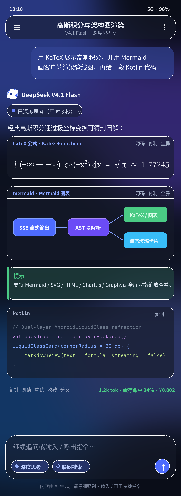

# DeepSeek Hot

遵循 [DeepSeek 构建 Chatbot 指南](https://api-docs.deepseek.com/zh-cn/guides/build_a_chatbot) 打造的第三方原生 Android 客户端。基于官方开源示例 [deepseek-ai/chat-demo](https://github.com/deepseek-ai/chat-demo) 的完整能力集合，采用 **Kotlin 2.4 + Jetpack Compose + [AndroidLiquidGlass](https://github.com/Kyant0/AndroidLiquidGlass)** 打造全应用实时光学折射液态玻璃体验，内置 **KaTeX / Mermaid / SVG / HTML / Chart.js / Graphviz / 语法高亮** 全能富文本渲染引擎、WebSocket 24kHz PCM 流式朗读、上下文硬盘缓存极致优化与三协议自由切换。

- 当前版本：`v3.0.0`（`versionCode = 6`） · [下载最新 Release APK](https://github.com/Hotsteel2901/DS-hot-chat-app/releases/tag/v3.0.0)
- 包名：`com.hotsteel.deepseekhot`
- 最低系统：Android 8.0（API 26），编译 SDK 37，目标 API 35
- 技术栈：Kotlin 2.4.10 / AGP 9.1.1 / Gradle 9.3.1 / Compose Material 3 / `io.github.kyant0:backdrop:2.0.1` + `shapes:1.2.1` / OkHttp / DataStore / kotlinx.serialization / Coil

## 界面预览

<p align="left">
  
  
  
</p>

> 展示 v3.0.0 完整 Liquid Glass 液态玻璃视觉体系（极光背景 + 实时光学折射卡片 + 悬浮输入卡 + KaTeX 公式 / Mermaid 图表 / Kotlin 语法高亮 / 三档性能调节设置页）。

## v3.0.0 更新亮点

- **完整版 Liquid Glass 液态玻璃（兼顾高刷性能）**：
  - 接入 [Kyant0/AndroidLiquidGlass](https://github.com/Kyant0/AndroidLiquidGlass)（`backdrop:2.0.1` + `shapes:1.2.1`），实现双层 `rememberLayerBackdrop` 光学折射、高斯模糊、色散高光、AGSL 追光按压反馈与可拖拽液态玻璃开关。
  - 全覆盖侧边抽屉、悬浮顶栏、悬浮输入卡、胶囊开关、消息气泡、思考块、搜索卡、TTS/搜索控制条、弹层、Snackbar 与设置页卡片。
  - 静态缓存极光壁纸零闲置重绘，并在「设置 → 外观与体验」提供 **完整折射 / 轻量性能 / 关闭** 三档性能开关。
- **全能富文本与代码图渲染引擎**：
  - **数学与化学公式**：全面支持 `$$...$$`、`\[...\]`、`\begin{align|equation|matrix|cases}` 块级公式以及 `$...$`、`\(...\)` 行内公式（含复杂行内公式自动切换 KaTeX+mhchem 排版，流式期实时 Unicode 降级防闪烁，支持复制源码与全屏双指缩放）。
  - **全类型代码图**：原生支持 **Mermaid v11**（流程图/时序图/类图/状态图/甘特图/思维导图等）、**SVG 矢量图**（含围栏外独立 `<svg>`）、**HTML/CSS/JS 沙盒互动预览**、**Chart.js 数据图表**、**Graphviz DOT 关系图** 以及 **ASCII / 目录树无折行结构图**，均支持一键切换「渲染图 / 源码」与全屏放大查看。
  - **完整 GFM 与语法高亮**：内置 20+ 语言语法高亮（含 Diff 增删着色）、GitHub Callouts（`> [!NOTE|TIP|IMPORTANT|WARNING|CAUTION]`）、任务清单（`- [x]` / `- [ ]`）、可点击放大图片、对齐表格，且 DeepSeek 深度思考块内也完整支持 Markdown 与公式渲染。
- **稳定性与 Bug 修复**：
  - 修复行内数学 `$`/`\` 扫描漏检导致公式不渲染的问题；
  - 修复语音录制组件离开页面时未释放 `AudioRecord` 的泄漏隐患，并加固 `getMinBufferSize` 异常保护；
  - 修复删除正在流式生成的会话时结束回调可能复活已删会话的竞态 Bug；
  - 加固消息列表 `LazyColumn` 复合键防重崩溃，并清洗 TTS 朗读中的 LaTeX 公式命令。

## v2.0.0 核心能力回顾

- **全新图标重绘**：深海极夜渐变 + 跃动鲸尾极光脉冲图腾，适配 Android 自适应图标与 Monochrome 单色图标。
- **WebSocket 24kHz PCM 流式朗读**：直连官方 `wss://api.deepseek.com/v1/tools/tts` 实时写入 `AudioTrack`（首音零等待，失败自动降级 HTTP PCM），支持全局悬浮朗读条、暂停/继续与 `0.75x–2.0x` 倍速切换。
- **上下文硬盘缓存极致优化**：冻结会话创建日期前缀消除分钟级抖动、Chat 模式剥离冗余 `reasoning_content`、Anthropic 注入 `cache_control: ephemeral` 缓存断点，并提供实时缓存命中率与节省金额看板。
- **7 大效率功能**：提示词角色预设工坊、悬浮朗读控制条、消息收藏夹、会话内关键词搜索跳转、Markdown 一键导出/分享、缓存命中率看板、`/` 快捷指令与会话分叉。

## 功能总览

| 能力 | 实现方式 |
| --- | --- |
| 联网搜索 & 深度搜索 | `deepseek_web_search` 工具，展示查询词、来源卡片与编号引用胶囊 |
| 阅读链接 & 文件解析 | `deepseek_read_url` 与 Files API（PDF / Office / 图片 / 文本） |
| 数学公式与代码图 | KaTeX + mhchem、Mermaid v11、SVG、HTML 互动沙盒、Chart.js、Graphviz DOT、ASCII 结构图与全屏缩放 |
| 代码与 Markdown | 20+ 语言语法高亮、Diff 着色、Callouts、任务清单、对齐表格、图片缩放、深度思考块富文本 |
| 语音交互（TTS / ASR） | WebSocket 24kHz PCM 流式朗读（倍速/暂停）+ 16kHz WAV 语音识别 |
| 液态玻璃与主题 | 完整折射 / 轻量性能 / 关闭三档调节 + 浅/深色手调色板 + Android 12+ 动态取色 |
| 多协议 & 网关兼容 | Chat Completions / Responses / Anthropic Messages 一键切换，原生兼容 OpenCode v2 / Go / Zen |
| 会话与数据管理 | 时间分组抽屉、置顶/重命名/搜索、消息收藏、分叉、编辑重发、续写、Markdown/JSON 导出与导入 |

## 网关兼容：OpenCode v2 / Go / Zen

Base URL 填 `opencode.ai` 系地址时自动切换端点形态与会话头，三种协议均可用：

| 网关 | Base URL | Chat | Responses | Anthropic |
| --- | --- | --- | --- | --- |
| OpenCode v2（Console，按量） | `https://opencode.ai/inference` | `/openai/v1/chat/completions` | `/openai/v1/responses` | `/anthropic/v1/messages` |
| OpenCode Go（订阅） | `https://opencode.ai/inference/go` | 同上 | 同上 | 同上 |
| Zen / Go（旧版） | `https://opencode.ai/zen/v1` | `/chat/completions` | `/responses` | `/messages` |

## 构建

```bash
# 需要 JDK 21、Android SDK（compileSdk 37）
export ANDROID_HOME=/path/to/android-sdk
echo "sdk.dir=$ANDROID_HOME" > local.properties

# 单元测试 + Lint + 编译 Debug / Release APK
./gradlew testDebugUnitTest lintDebug assembleDebug assembleRelease
```

安装：

```bash
adb install -r app/build/outputs/apk/release/app-release.apk
```

首次启动进入「设置」填入 DeepSeek API Key（`sk-...`），点击「保存并测试」即可拉取模型列表与余额。

## 目录结构

```
app/src/main/java/com/hotsteel/deepseekhot/
├── AppViewModel.kt          会话/流式状态/模型/余额/统计/附件/TTS 状态源
├── MainActivity.kt          edge-to-edge + Compose 入口
├── data/
│   ├── Models.kt            @Serializable 数据模型与 AppSettings（含液态玻璃档位）
│   └── Repositories.kt      DataStore 设置、会话 JSON 文件、本地统计
├── net/
│   ├── ApiClient.kt         OkHttp、SSE、WebSocket TTS、ASR、/models、/user/balance、/files
│   ├── Gateway.kt           网关识别（OpenCode v2/Go/Zen）、端点映射、x-opencode-session
│   └── ChatEngine.kt        三协议请求构建、缓存优化与统一流式事件解析
├── audio/Audio.kt           WAV 录音（AudioRecord）与 24kHz PCM 流式 AudioTrack 播放
├── ui/
│   ├── liquid/
│   │   ├── LiquidPhysics.kt          Kyant0 交互高光 AGSL 着色器与阻尼弹簧拖拽物理
│   │   └── LiquidGlassComponents.kt  双层 Backdrop、静态极光壁纸、三档性能模式与可拖拽玻璃开关
│   ├── RichWebRenderer.kt   KaTeX+mhchem / Mermaid v11 / SVG / Chart.js / Graphviz / HTML 引擎
│   ├── SyntaxHighlighter.kt 20+ 语言语法高亮与 LaTeX Unicode 降级美化器
│   ├── Markdown.kt          完整 GFM + 块/行内公式 + 代码图 + Callouts + 任务列表 + 图片缩放
│   ├── AppRoot.kt           双层 Backdrop 根容器、液态玻璃抽屉、转场与 Snackbar
│   ├── ChatScreen.kt        液态玻璃顶栏、消息列表、流式跟随滚动、回底按钮与会话菜单
│   ├── MessageItems.kt      液态玻璃气泡、富文本思考块、搜索卡、引用胶囊与用量统计
│   ├── Composer.kt          液态玻璃悬浮输入卡、胶囊开关、`/` 指令、语音输入与附件
│   ├── FeatureSheets.kt     悬浮朗读条、会话搜索条、角色预设工坊与收藏夹面板
│   ├── Sheets.kt            模型/协议/思考强度面板、缓存命中率与余额统计看板
│   ├── SettingsScreen.kt    液态玻璃分组设置页（含三档液态玻璃开关）
│   ├── Welcome.kt           液态玻璃居中欢迎页与快捷示例卡片
│   ├── AboutScreen.kt       关于页（v3.0.0 能力清单与作者信息）
│   └── theme/Theme.kt       浅/深色中性色板、品牌蓝、字体与形状系统
└── util/Format.kt           格式化、缓存节省计费估算、Markdown 导出与系统工具
```

## 与官方 Demo 的对比

| 项目 | DeepSeek Hot v3.0.0 | 官方 chat-demo |
| --- | --- | --- |
| 视觉交互 | 完整 AndroidLiquidGlass 液态玻璃（三档性能可调） | Web 极简风格 |
| 接口协议 | Chat / Responses / Anthropic 三协议切换 + OpenCode 兼容 | 仅 Anthropic Messages |
| 语音合成 | WebSocket 24kHz PCM 实时流式 + HTTP 降级 + 倍速/暂停 | 整段 + WebSocket 流式 |
| 公式与图表 | KaTeX+mhchem、Mermaid、SVG、HTML、Chart.js、Graphviz、ASCII | KaTeX 渲染、Mermaid 绘制 |
| 上下文缓存 | 自动冻结前缀 + 协议缓存断点 + 命中率/省钱看板 | 基础缓存 |

## 许可证

本项目以 **AGPL-3.0-or-later**（GNU Affero General Public License v3.0 或更高版本）发布，全文见 [LICENSE](LICENSE)。

## 作者

- GitHub：[@Hotsteel2901](https://github.com/Hotsteel2901)
- Email：i.r.hotsteel@gmail.com
